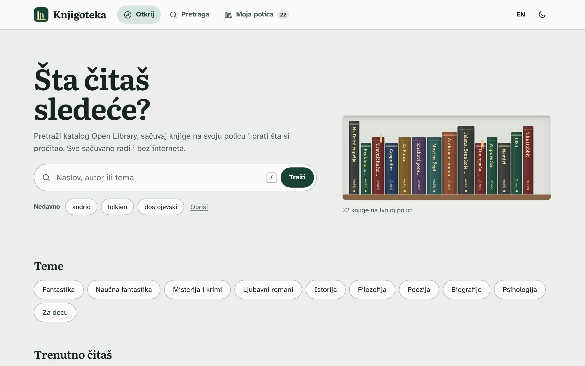

# Knjigoteka

PWA for searching books from [Open Library](https://openlibrary.org) and keeping your own reading shelf. It works offline and can be installed on a phone or computer. Started as my bachelor thesis.

**Live:** https://nikolxdev.github.io/knjigoteka/



## What it does

- search with filters and sorting
- shelf with statuses (want to read / reading / read), ratings and notes
- works offline thanks to a service worker
- light and dark theme, Serbian and English

No framework, just JavaScript modules. The app is in the `app/` folder.

## Run it

```
npm install
npm start
```

Opens on http://localhost:8080.

## Tests

```
npm test
npx playwright install chromium
npm run test:e2e
```

Unit tests for the logic and end-to-end tests with Playwright. When changing app files, bump `VERSION` in `app/sw.js`.

Book data and covers are from Open Library.

## License

© 2026 Nikola Vojvodić. All rights reserved. The code is public so it can be read and evaluated as part of my portfolio; it is not open source. See [LICENSE](LICENSE) for what is and isn't allowed.
